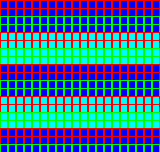
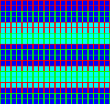
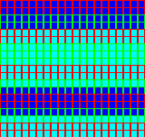

# NGPC scroll tests

Small, source-available Neo Geo Pocket Color homebrew ROMs for checking scanline scroll updates. The patterns and code are included so emulator authors can reproduce the behavior without commercial games or private save states.

## Download and run

Download the three `.ngc` files from [roms/](roms/) or the [releases page](https://github.com/Blueteemo/ngpc-scroll-tests/releases). Each is 64 KiB. Open one as a normal NGPC cartridge; there are no controls. After initialization the same diagnostic pattern repeats every frame. A separate BIOS is not bundled; emulator requirements vary. The recorded comparisons used each emulator's HLE.

| ROM | Behavior |
| --- | --- |
| [static.ngc](roms/static.ngc) | Control: two original grid/band layers, with zero scroll. |
| [single.ngc](roms/single.ngc) | Poll `0x8009` for raster line 64, then write SCR1 Y (`0x8033`) = 8. Reset both layer Y offsets on line 160. |
| [same_line.ngc](roms/same_line.ngc) | On line 64, write SCR1 Y=8, SCR2 Y=16, SCR1 Y=24, SCR2 Y=32 in that order. Reset both on line 160. |

The line numbers above are polling targets, not a guarantee of write timing on every implementation. In the recorded NGPDS and Beetle/Mednafen runs, the dynamic writes actually occurred on line 64 and the resets on line 160. Lines are zero-based.

## Observed behavior

In the tested Beetle/Mednafen core, row 63 retains the old offsets and row 64 uses the new offsets. Unmodified NGPDS main (`5069cacf1afcdd0aeb014abdc2b419b50ed0d2fa`, K2GE `e6b936de7abe43b5244893e59a4323d97e910c17`) changes row 63 early. The static control matches. The single-write test differs on 40 pixels of row 63; the same-line test differs on 120 pixels of row 63, comparing RGB channels quantized to five bits.

These tests helped isolate an extra entry in K2GE's backward scroll-span fill. They do **not** establish hardware timing or that any proposed emulator patch is fully correct. See [observations and limits](docs/OBSERVATIONS.md).

Reference captures (160×152, no spatial/frame-offset search):

| Static control | Single write | Same-line writes |
| --- | --- | --- |
|  |  |  |

## Build from source

Requirements: Python 3 and Alfred Arnold's Macroassembler AS (`asl` and `p2bin`) with TLCS-900 support. Tested with AS V1.42 Beta build 306 from [asl-releases](https://github.com/Macroassembler-AS/asl-releases) commit `c7155b4fd3d33110f0eb098dede4295a8c008772`. This repository does not bundle the assembler or emulator binaries.

With the tools in PATH:

```sh
./build.sh
```

Or use explicit paths:

```sh
ASL=/path/to/asl P2BIN=/path/to/p2bin ./build.sh
```

The script assembles the three programs, packages their cartridge headers, and checks that each rebuilt ROM is byte-identical to its published counterpart. Output stays in `build/`. See [tool provenance and licensing](docs/PROVENANCE.md). `SHA256SUMS.txt` covers the published files except itself.

## Scope and license

This is a focused scrolling diagnostic, not a general compatibility suite. It does not test sprites, audio, saving, arbitrary frame periods, or physical hardware. No commercial ROM, BIOS, game screenshot, or personal save is included.

Original diagnostic sources, ROMs, documentation and synthetic reference captures are provided under the [MIT License](LICENSE). The included NGPC ROM packager is from NgpCraft_MCP and retains its [MIT notice](LICENSES/NgpCraft-MIT.txt). The cartridge header identification string is a format requirement; it does not indicate SNK approval, authorship or a commercial license.
